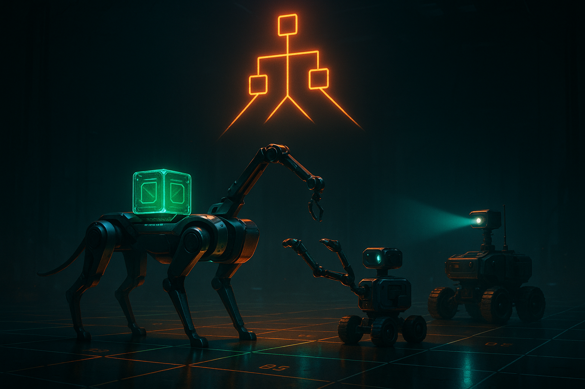
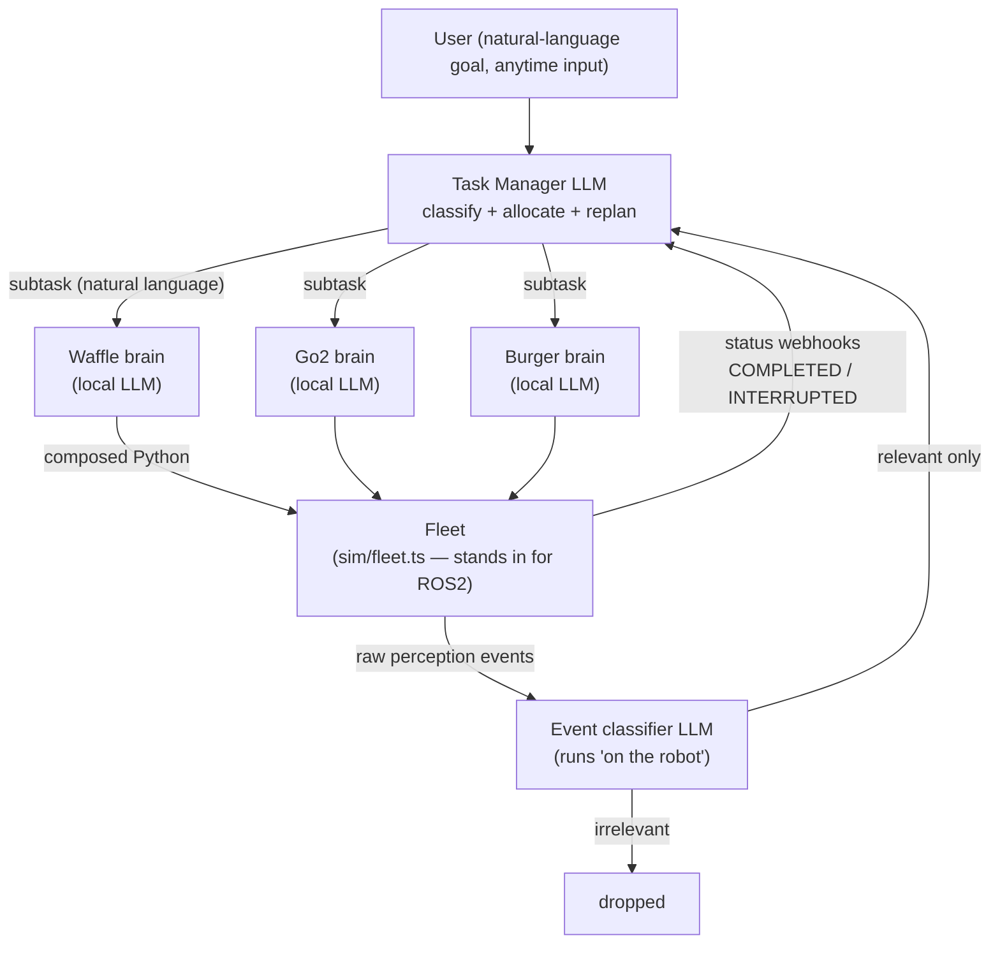
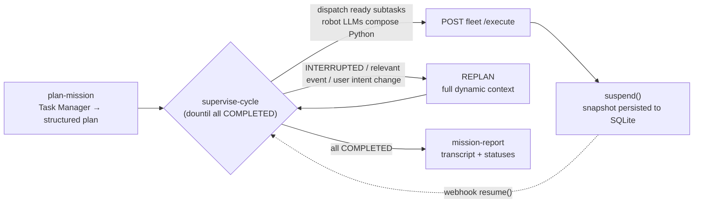

<p align="center">
  
</p>

<h1 align="center">CoMuRoS on Mastra</h1>

<p align="center">
  <b>LLM-based hierarchical task planning for heterogeneous robot teams, with event-driven replanning.</b><br/>
  A working reverse-engineering of <a href="https://arxiv.org/abs/2511.22354">arXiv:2511.22354</a> — <i>"LLM-Based Generalizable Hierarchical Task Planning and Execution for Heterogeneous Robot Teams with Event-Driven Replanning"</i> (Borate, Rai, Pardeshi, Vadali) — built on the <a href="https://mastra.ai">Mastra</a> agent framework.
</p>

---

## What is this?

The paper introduces **CoMuRoS** (Collaborative Multi-Robot System): a hierarchy modeled on human organizations. A user gives a natural-language goal to a centralized **Task Manager LLM**, which classifies the goal, splits it into subtasks, and allocates them to robots based on their capabilities, morphologies, and constraints. Each robot runs its own **local LLM** that composes executable Python from a library of primitive skills. Robots proactively report progress and perceived events; **relevant** events (a dropped payload, a changed user intent) trigger the Task Manager to **replan mid-mission** — diverting robots to assist teammates, resuming interrupted work, or asking a human for help.

This repo re-implements that architecture 1:1 on Mastra primitives, replacing the physical layer (ROS2, real robots, VLM perception) with a **simulated fleet driven over REST webhooks** — so the whole deliberation/replanning loop runs end-to-end on your laptop.

| Paper concept (§) | Implementation |
|---|---|
| Task Manager LLM: classify, allocate, replan (§III-A) | Supervisor [`Agent`](src/mastra/agents/task-manager.ts) with the paper's static prompt as instructions; robot brains registered as sub-agents |
| Four-way task classification (§I) | Zod [structured output](src/mastra/schemas/index.ts): `independent \| sequential \| coordinated \| infeasible` |
| Robot Brain: Python composed from primitive skills (§III-B) | One [sub-agent per robot](src/mastra/agents/robots.ts), generated from the scenario config; returns `{ code, functionsUsed }` |
| Event detection + relevance filtering (§III-B) | [Event classifier agent](src/mastra/agents/event-classifier.ts) invoked inside the event webhook — irrelevant events never reach the Task Manager |
| Event-driven replanning (§III-A, IV-A1) | Mastra **workflow suspend/resume**: the [mission workflow](src/mastra/workflows/mission.ts) suspends after dispatch; webhooks resume it with status reports, relevant events, or user input |
| Task status `COMPLETED / IN_PROGRESS / INTERRUPTED` (§III-A) | Workflow state, plus `PENDING` for not-yet-dispatched subtasks |
| Scenario configuration file (contribution 4) | [`src/mastra/config/scenario.ts`](src/mastra/config/scenario.ts) — swap robots, skills, and rules without touching the planner |
| Human–robot collaboration (§IV-A2) | Subtasks can be assigned to `"human"`; humans confirm via the user webhook |
| Chat interface with color-coded history (§III-C) | Chat transcript kept in workflow state; the demo prints it color-coded (user = blue, task manager = orange, events = green) |
| Hardware experiments (§IV-A) | Two scripted demos reproduce the paper's disruption and distraction experiments against the simulated fleet |

## Concepts

### The hierarchy



**Centralized deliberation, decentralized execution.** The Task Manager never writes robot code; it hands each robot a natural-language instruction. Each robot's own LLM decomposes it against its private skill library (`find`, `reach`, `pick`, `place_on`, `sit`, `carry_to`, …) and emits ready-to-run Python. The Task Manager also never sees noise: event relevance is classified at the robot boundary, so a red herring thrown in front of a robot costs one cheap classifier call and zero replans.

### Task classification

Every goal is classified as exactly one of:

- **independent** — subtasks run in parallel with no cooperation (one robot waters plants, another cooks)
- **sequential** — later subtasks depend on earlier completions (cook, *then* serve)
- **coordinated** — tightly coupled simultaneous motion (formation transport)
- **infeasible** — beyond the whole system, humans included (asking a ground robot to fly)

Ordering is operationalized with an explicit `dependsOn` list per subtask. This is the one deliberate deviation from the paper, which resolves dependencies implicitly through context: a deterministic dispatch engine needs the Task Manager to *emit* the ordering it inferred. Same reasoning, made executable.

### The mission lifecycle (suspend/resume)



The `supervise-cycle` step dispatches every subtask whose dependencies are `COMPLETED`, then **suspends**. The run snapshot (including the full mission state: plan, statuses, chat history) persists in LibSQL, surviving restarts. Three things can wake it:

1. **Status report** — a robot finished (`COMPLETED`) or failed (`INTERRUPTED`) a task
2. **Relevant event** — perception saw something that affects the mission
3. **User input** — a new command, an intent change ("I don't want it anymore"), or a human confirming a task assigned to them

Replanning follows the paper's procedure: only non-`COMPLETED` tasks are reconsidered, `INTERRUPTED` tasks must reappear (resumed or replaced by a recovery sequence), robots can be diverted to assist teammates and then resume their own work, identical `IN_PROGRESS` tasks keep running without re-dispatch, and work beyond every robot's capability goes to a human.

### The scenario config is the whole domain

[`scenario.ts`](src/mastra/config/scenario.ts) declares the robots (morphology, capabilities, constraints, primitive skill signatures) and scenario rules. The default scenario mirrors the paper's hardware experiment IV-A1: a **Turtlebot Waffle-pi + OpenManipulator-X arm**, a **Turtlebot Burger** (observer), and a **Unitree Go2 quadruped** — including the load-bearing rule that *Waffle's arm can only reach the quadruped's back while it sits*. That single config line is what makes the replanned recovery sequence include "Go2: sit" before the handover, exactly as in the paper. New domain = new config; planner, workflow, and webhooks are untouched.

## How to use it

### Prerequisites

- Node.js 20+
- An LLM API key in your environment (default model is `openai/gpt-4o`, the paper's hardware-trial model):

```bash
export OPENAI_API_KEY=sk-...
```

### Install & run

```bash
npm install

# terminal 1 — Mastra server + Studio (port 4113)
npm run dev

# terminal 2 — simulated robot fleet (port 4222)
npm run fleet
```

### Run the paper's experiments

**Experiment 1 — disruptive event & recovery** (paper §IV-A1, Fig. 4). Mid-mission, the green object is knocked off Go2's back; Burger reports it; the classifier marks it relevant; the Task Manager replans (Waffle picks it up, Go2 sits for the handover, Go2 resumes delivery):

```bash
npm run demo
```

Expected: color-coded live transcript, `mission success | replans: 1`, all subtasks `COMPLETED`, `PASS`.

**Experiment 2 — irrelevant distraction** (paper Fig. 5). A red object is thrown in front of Burger; the event is classified irrelevant and dropped without waking the Task Manager:

```bash
npm run demo:irrelevant
```

Expected: `mission success | replans: 0`, `PASS`.

### Drive it yourself over HTTP

Start a mission:

```bash
curl -s -X POST localhost:4113/missions \
  -H 'content-type: application/json' \
  -d '{"command": "Waffle: go to the bottle. Go2: carry the green object to (3, 0)."}'
# -> { "runId": "...", "status": "suspended", "suspended": [...] }
```

Watch it (statuses, replan count, full chat transcript):

```bash
curl -s localhost:4113/missions/<runId>
```

Report robot status (what a real ROS2 status topic would publish):

```bash
curl -s -X POST localhost:4113/webhooks/robots/go2/status \
  -H 'content-type: application/json' \
  -d '{"runId": "<runId>", "taskId": "go2-carry-green", "status": "INTERRUPTED", "note": "payload lost"}'
```

Raise a perception event (classified for relevance before it can trigger a replan):

```bash
curl -s -X POST localhost:4113/webhooks/robots/burger/events \
  -H 'content-type: application/json' \
  -d '{"runId": "<runId>", "description": "The green object fell off the quadruped at (1.5, 0)."}'
# -> { "relevant": true|false, "reasoning": "...", "forwarded": ... }
```

Anytime human input — intent changes replan; task confirmations complete human-assigned subtasks:

```bash
# intent change → replan
curl -s -X POST localhost:4113/webhooks/user \
  -H 'content-type: application/json' \
  -d '{"runId": "<runId>", "message": "Actually, forget the bottle."}'

# human finished a task the Task Manager assigned to them
curl -s -X POST localhost:4113/webhooks/user \
  -H 'content-type: application/json' \
  -d '{"runId": "<runId>", "message": "done", "taskId": "human-place-ball", "status": "COMPLETED"}'
```

Inject a disruption through the fleet (what the demos do):

```bash
curl -s -X POST localhost:4222/disrupt \
  -H 'content-type: application/json' \
  -d '{"runId": "<runId>", "cancelRobot": "go2", "statusNote": "payload lost",
       "eventFrom": "burger", "eventDescription": "The green object fell off the quadruped."}'
```

You can also chat with the Task Manager interactively in **Mastra Studio** at `http://localhost:4113` — the robot brains are registered as sub-agents, so it delegates conversationally too.

### Configuration knobs

| Env var | Default | Purpose |
|---|---|---|
| `COMUROS_MODEL` | `openai/gpt-4o` | Task Manager (and fallback for all agents) |
| `COMUROS_ROBOT_MODEL` | `COMUROS_MODEL` | Robot brains — point at a small/local model to mirror the paper's "local LLM per robot" |
| `COMUROS_EVENT_MODEL` | `COMUROS_MODEL` | Event relevance classifier |
| `COMUROS_PORT` | `4113` | Mastra server port |
| `FLEET_PORT` / `FLEET_URL` | `4222` / `http://localhost:4222` | Simulated fleet |
| `EXEC_MS` | `6000` | Simulated execution time per task |
| `MASTRA_URL` | `http://localhost:4113` | Where the fleet/demo post webhooks |

If the fleet isn't running, dispatch degrades to dry-run: tasks stay `IN_PROGRESS` and you drive them manually with the status webhook.

## Repository layout

```
src/mastra/
  config/scenario.ts        # robots, skills, constraints, scenario rules (the swappable domain)
  schemas/index.ts          # classification, plan, code-plan, event, status, state schemas (zod)
  agents/task-manager.ts    # centralized Task Manager (supervisor; static prompt from the paper)
  agents/robots.ts          # robot-brain sub-agent factory (one per configured robot)
  agents/event-classifier.ts# relevant/irrelevant event filtering
  workflows/mission.ts      # plan → dountil(supervise-cycle) → report; suspend/resume core
  server/routes.ts          # /missions + webhook routes (the mocked event-detection layer)
  lib/registry.ts           # in-memory mission registry + serialized, wait-for-suspend resume
  lib/fleet-client.ts       # dispatch boundary to the simulated fleet
sim/
  fleet.ts                  # simulated robots: one task at a time, status callbacks, /disrupt
  demo.ts                   # scripted reproductions of the paper's two hardware experiments
```

## Deviations from the paper

- **Explicit `dependsOn`** instead of fully implicit ordering (see [Concepts](#task-classification)).
- **Actuation and perception are mocked** as REST webhooks (`sim/fleet.ts`); the paper runs ROS2 nodes, RL policies, and OwlViT/GPT-4.1 VQA on hardware.
- **One shared event-classifier agent** parameterized per robot, rather than a separate LLM process per robot — identical behavior, fewer moving parts.
- The paper's 22-scenario textual benchmark (§V) is not included.

## Reference

> Suraj Borate, Bhavish Rai B, Vipul Pardeshi, Madhu Vadali.
> *LLM-Based Generalizable Hierarchical Task Planning and Execution for Heterogeneous Robot Teams with Event-Driven Replanning.*
> [arXiv:2511.22354](https://arxiv.org/abs/2511.22354), 2025.
